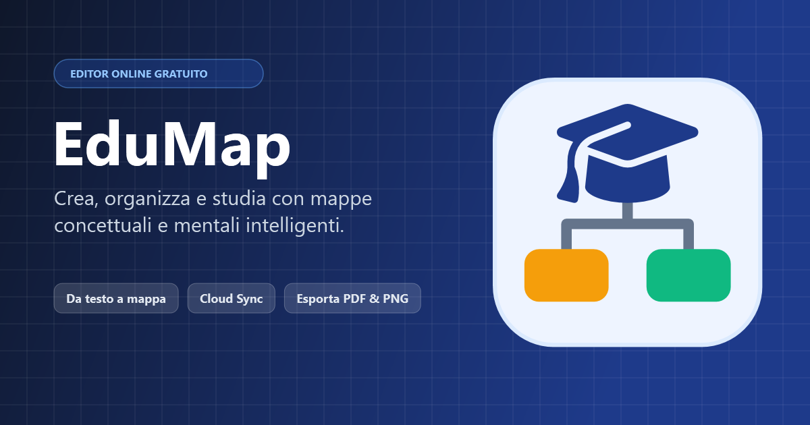

# EduMap – Editor di Mappe Concettuali e Mentali Online



**EduMap** è un'applicazione web moderna, accessibile e completa per ideare, organizzare e studiare tramite **mappe concettuali** e **mappe mentali**. Permette di trasformare appunti, scalette e testi in mappe visive ordinate in pochi secondi, sincronizzarle nel cloud e scaricarle in PDF ad alta risoluzione o formati vettoriali.

---

## 🌟 Funzionalità Principali

### 🧠 Creazione e Disposizione Intelligente
- **Generatore da Testo / Scaletta:** incolla qualsiasi appunto con rientri o elenchi puntati; EduMap riconosce i livelli gerarchici e le parole legame (es. `[è formato da]`) creando istantaneamente la mappa.
- **Layout Automatici Multipli:**
  - *Gerarchico dall'alto verso il basso* (ideale per mappe concettuali scolastiche e universitarie).
  - *Orizzontale da sinistra a destra* (processi, timeline e cicli).
  - *Mappa Mentale bilanciata (radiale)* per brainstorming e mappe cognitive.
- **Modalità Libera con Riallineamento:** sposta e ridimensiona liberamente i singoli concetti quando desideri, con un pulsante dedicato per ripristinare l'allineamento automatico in qualsiasi momento.
- **Scorciatoie da Tastiera Veloci:** <kbd>Tab</kbd> per aggiungere un figlio, <kbd>Invio</kbd> per un fratello, <kbd>F2</kbd> o doppio clic per modificare, <kbd>K</kbd> per collegamenti trasversali.

### 🗂 Organizzazione in Cartelle & Dashboard
- **Dashboard Mappe:** vista a griglia con anteprime vettoriali in tempo reale, ricerca istantanea per titolo e conteggio concetti.
- **Cartelle a Colori:** raggruppa le tue mappe per materia (Storia, Scienze, Filosofia, Diritto, ecc.) con colori personalizzati e filtro rapido.
- **Drag & Drop:** trascina le schede delle mappe direttamente sulle cartelle della barra laterale per organizzarle al volo.

### ☁ Cloud Sync & Multi-dispositivo (Supabase)
- **Salvataggio Online Sicuro:** accesso e registrazione gratuiti basati su Supabase Auth e PostgreSQL con policy RLS (*Row Level Security*).
- **Sincronizzazione Automatica:** ogni modifica viene salvata in locale e sincronizzata nel cloud in background.
- **Recupero Password e Profilo:** gestione completa dell'account direttamente dall'interfaccia.

### 🖨 Esportazione Tipografica e Condivisione
- **PDF Vettoriale Multi-pagina e Poster:** esporta in formato A4, A3, A5 o Letter, su foglio singolo o suddiviso su 2, 4, 6 o 9 fogli per poster di grandi dimensioni.
- **Download Rapido in 1 Clic:** scarica subito la mappa in PDF dalla griglia principale o dalla barra strumenti.
- **Formati Multipli:** esportazione in immagini PNG ad alta risoluzione, vettoriale SVG limpido, file JSON interoperabile e scaletta `.txt`.
- **Sintesi Vocale Inclusiva:** lettura ad alta voce della mappa per l'apprendimento inclusivo (DSA e BES).

### 📱 Esperienza Mobile Ottimizzata
- **Consultazione e Download Rapido da Smartphone:** interfaccia mobile dedicata con elenco cartelle a chip orizzontali, ricerca veloce e download immediato dei PDF.
- **PWA Ready:** installabile come Web App su Android e iOS grazie al Web App Manifest.

---

## 🚀 Architettura e Stack Tecnologico

- **Frontend:** Vanilla JavaScript (ES6+ Modules), HTML5 semantico, CSS3 Moderno con CSS Custom Properties e layout Grid/Flexbox.
- **Grafica Vettoriale:** SVG interattivo con motore di layout ad albero proprietario.
- **Generatore PDF:** Generatore binario PDF 1.4 nativo client-side senza dipendenze pesanti.
- **Backend & Database:** Supabase (PostgreSQL 15+, Auth JWT, Row Level Security, Storage).
- **Deployment:** Ottimizzato per **Vercel** con serverless function `/api/config` per la distribuzione sicura delle credenziali pubbliche.

---

## 🛠 Configurazione e Installazione

### 1. Esecuzione in Locale
Puoi avviare EduMap con qualsiasi server statico HTTP:
```bash
# Esempio con npx serve
npx serve .

# Oppure con Python
python -m http.server 3000
```

### 2. Configurazione Database Supabase
1. Crea un progetto gratuito su [Supabase](https://supabase.com).
2. Nel pannello Supabase vai su **SQL Editor** ed esegui lo script contenuto in [`supabase/schema.sql`](supabase/schema.sql).
3. Incolla il tuo *Project URL* e la *Anon/Publishable Key* in `js/config.js` per il test locale, oppure configurali come variabili d'ambiente su Vercel.

### 3. Deploy su Vercel
1. Collega il repository su [Vercel](https://vercel.com).
2. Aggiungi nelle impostazioni di progetto (**Settings -> Environment Variables**):
   - `SUPABASE_URL`: l'URL del tuo progetto Supabase (es. `https://xyzcompany.supabase.co`)
   - `SUPABASE_ANON_KEY`: la chiave pubblica anonima di Supabase
3. Effettua il Deploy. La funzione `/api/config` fornirà automaticamente i parametri sicuri all'app.

---

## 🔍 SEO e Indicizzazione

EduMap include un'infrastruttura SEO completa e avanzata:
- **Meta tag Open Graph & Twitter Cards** con anteprima visuale dedicata (`og-image.png`).
- **Dati strutturati Schema.org JSON-LD:** `WebApplication`, `WebSite`, `Organization` e `FAQPage` per rich snippets nei motori di ricerca.
- **Sitemap XML e Robots.txt:** indicizzazione corretta e monitoraggio tramite Google Search Console e Bing Webmaster Tools.
- **Web App Manifest (`manifest.json`):** indicizzazione mobile-first e installabilità su smartphone e tablet.
- **Contenuto semantico `<noscript>`:** garantisce la piena leggibilità del testo e delle parole chiave anche ai crawler privi di motore JavaScript attivo.

---

## 📄 Licenza
Rilasciato sotto licenza MIT.
